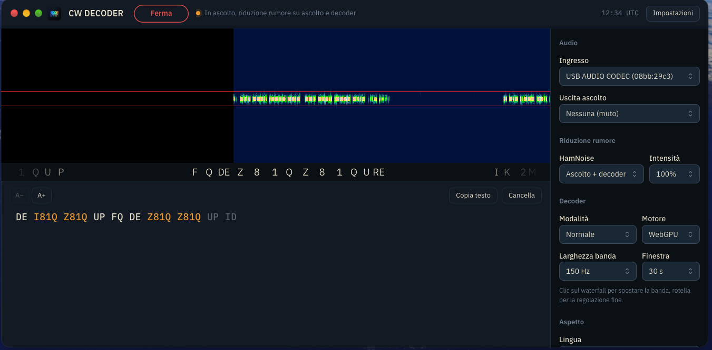

# CW DECODER for macOS (Apple Silicon)

**CW DECODER** is a desktop app for Mac computers with Apple Silicon (M1–M4) that decodes Morse code (CW) in real time from your radio's USB audio interface. It combines two open-source projects by e04:

- **[DeepCW](https://github.com/e04/web-deep-cw-decoder)** – a neural-network CW decoder
- **[HamNoise](https://github.com/e04/HamNoise)** – a neural-network noise reduction filter for amateur radio audio

The original web apps are packaged in an Electron shell, so everything runs **locally and offline**: no browser, no server, no network connection needed.

Built by IU6CWS (Damian), JN72ib.



*Main window: waterfall with decoding passband, live decoded line, decoded text with callsigns highlighted, and the Settings panel (audio input/output, HamNoise, decoder, appearance).*

---

## What's new in 1.2.2

- **Automatic tuning (AFC).** Until a signal is found the decoder reads the whole 400–1200 Hz band, as before. Once it finds a signal it narrows the passband onto it and follows it if it drifts. Click the waterfall to lock onto a different station. Turn it off in *Settings › Decoder › Automatic tuning (AFC)*.
- **Narrower default passband: 150 Hz** (was 800 Hz), applied to existing installs too. A narrow filter keeps adjacent QRM out of the decoder.
- **No lost audio when retuning.** Moving or narrowing the passband used to discard the few seconds of audio waiting to be decoded; now that only happens when you jump to a different station.

Measured on a recorded QSO with QRM at 610 and 870 Hz, fed to the app as its audio input: character error rate went from **27.1 % (v1.2.1) to 4.8 % (v1.2.2)**. In a pile-up recording the two versions decode about the same, since there the errors come from overlapping callers.

## Features

- Real-time CW decoding from any audio input (radio USB sound card, interface, microphone)
- **HamNoise noise reduction** with three modes:
  - **Off** – no noise reduction
  - **Monitor only** – cleans only the audio you listen to (default)
  - **Monitor + decoder** – also feeds the cleaned audio to the waterfall and the decoder
- Separate **monitor output** selection (headphones / speakers)
- **Automatic tuning (AFC)**: finds the CW signal, centres a narrow passband on it and follows it
- Interactive **waterfall**: click to move the decoding passband, scroll to fine-tune
- **Pileup mode** to decode several signals at the same time
- Choice of inference engine: **WASM** or **WebGPU**
- Modern dark UI with a large area for decoded text
  - **A- / A+** to change the text size
  - **Copy text** to the clipboard, **Clear** to empty the window
  - Callsigns automatically highlighted in amber
  - Collapsible Settings side panel
- **Bilingual interface (Italian / English)** – both the app and the macOS menu bar. On first launch it follows the system language; change it in *Settings › Appearance* or in the *Language* menu.

## Requirements

- Mac with Apple Silicon (arm64), recent macOS
- An audio input carrying the receiver audio (e.g. the radio's built-in USB audio codec)

## Download

**[⬇ CW-DECODER-mac-arm64.zip](https://github.com/iu6cws/CW-DECODER-mac-arm64/releases/download/v1.2.2/CW-DECODER-mac-arm64.zip)** (≈130 MB, macOS Apple Silicon) – or see all [Releases](https://github.com/iu6cws/CW-DECODER-mac-arm64/releases)

## Installation

1. Unzip the archive and drag **`CW DECODER.app`** into the **Applications** folder.
2. The app is not signed with an Apple Developer certificate, so macOS reports it as "damaged" and refuses to open it. In Terminal, remove the quarantine flag and give it a local ("ad hoc") signature:
   ```bash
   xattr -cr "/Applications/CW DECODER.app"
   codesign --force --deep -s - "/Applications/CW DECODER.app"
   ```
   If macOS still blocks it, right-click the app › **Open** › **Open**, or go to *System Settings › Privacy & Security* and click **Open Anyway**.
3. On first launch, **allow microphone access** – it is required to read the USB audio input.

## Usage

1. Press **Start**.
2. Open **Settings** and select your radio's USB audio interface under **Input**.
3. Choose where to hear the audio under **Monitor output**.
4. Set the **noise reduction** mode you prefer.
5. With automatic tuning on (default) the passband locks onto the signal by itself. Click another signal in the waterfall to switch station. With AFC off, click the signal to centre the passband on it.

Decoded text appears in the main window; callsigns are highlighted.

## How it works

- `main.js` serves the bundled web app from a private secure scheme (`app://deepcw`) with cross-origin isolation headers, so that audio capture, AudioWorklet, WebAssembly threads and WebGPU all work offline.
- Only the bundled app is granted access to audio devices; external links open in the default browser, never inside the app.
- The window keeps decoding even when hidden (background throttling disabled).
- The macOS menu is localized in Italian and English and follows the language selected in the app.

### Folder layout

```
CW DECODER.app/
└── Contents/Resources/app/
    ├── main.js        Electron main process (secure scheme, permissions, menus)
    ├── preload.js     Bridge for the language setting
    ├── package.json
    ├── web/           DeepCW + HamNoise web app (models, WASM, worklets)
    ├── LICENSE-DeepCW.txt
    └── LICENSE-HamNoise.txt
mac-README.txt         Quick guide (English)
mac-LEGGIMI.txt        Quick guide (Italian)
docs/screenshot.png    Screenshot
```

A Windows 64-bit build of the same app is also available (named *DeepCW*).

## Credits & license

- **DeepCW** – https://github.com/e04/web-deep-cw-decoder – MIT License, © 2026 e04
- **HamNoise** – https://github.com/e04/HamNoise – MIT License, © 2026 e04
- Desktop packaging, UI changes and Italian/English localization by **IU6CWS**

This project is distributed under the MIT License. See the license files included in the app bundle.

73 de IU6CWS
